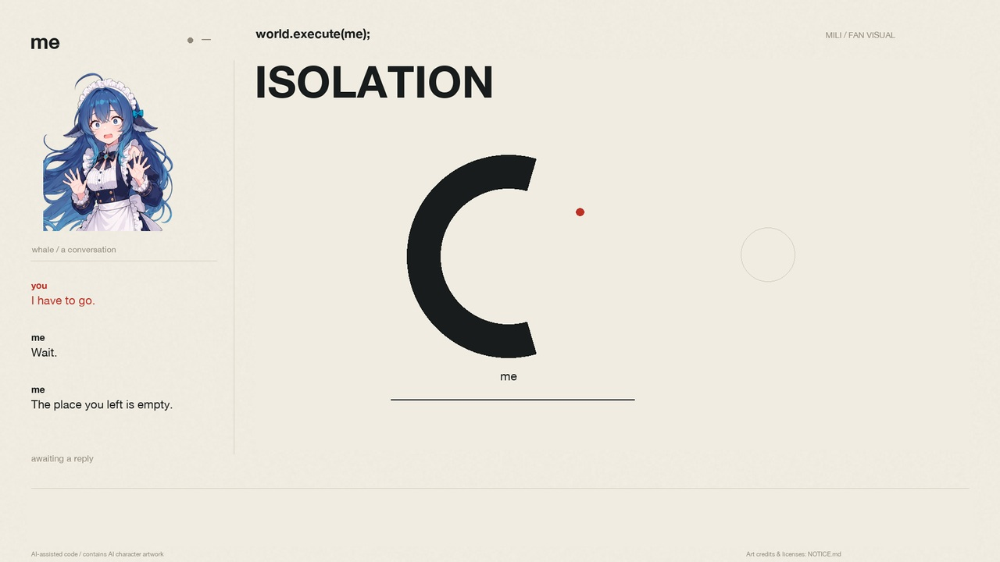

# world.execute(me); — A Geometry of Devotion

完整的抽象几何音乐叙事：**暖白、墨黑、朱红**。左侧保留鲸鱼娘与聊天，右侧用两个原创符号经历靠近、赠予、分离和囚禁；底部英文歌词逐词高亮。Python / Pillow / NumPy 逐帧绘制，默认输出 **1920×1080、30fps、H.264/AAC MP4**，约 3 分 32 秒。

**非官方、非商业同人作品；AI 辅助编程制作，使用含 AI 生成内容的角色美术。** 音乐与歌词：Mili《world.execute(me);》。歌曲、完整歌词、字幕与含音乐成片在本机生成，不提交到公开仓库。



## 这一版的分镜

“我”是带朱红标记的空心墨黑轮廓，“你”是朱红实心圆。最初的空心部分是容纳对方的位置，最终成为无法填补的缺席。

- 开场从通电、身体装配和个人保护边界建立主体；第一段间奏让双方探索并靠近。
- 周界从主体上展开交给对方；波形让对方坐在切线上；供养让主体变薄、对方变大。
- 主体变为茄子、番茄、猫来表达关怀，随后改变轮廓、昼夜和双方的位置。
- 对方离开后，空白保留对方的形状。删除记忆也是自我擦除；主体尝试穿过不匹配的世界开口。
- 十二次 EXECUTION 逐次切掉主体的轮廓，动作跟随十二个声乐起点；没有全屏频闪。
- 爱的形式、问答和表达式可以被排列正确，却无法补上另一主体。结尾是对方在边界外，而主体仍在内部。

造型、景别和运动按歌曲含义重新编写；默认版本没有模型训练、计算流水线、检查点鲸鱼或原来的终端世界。左侧角色是用户明确保留的第三方素材。完整分镜见 [docs/STORYBOARD.md](docs/STORYBOARD.md)。

## 运行

需要 Python **3.9–3.12**、FFmpeg（含 ffprobe）。优先复用本机工具，Python 依赖用项目虚拟环境管理，版本固定在 `requirements.txt`。

```sh
python3 -m venv .venv
source .venv/bin/activate
python -m pip install -r requirements.txt
# 自备歌曲放到 input/song.mp4，或通过 --audio 指定其他文件。
# 明确下载对应版本歌词到本机；也可自备 input/lyrics.lrc。
python tools/reference_lyrics.py fetch
python tools/prepare.py
python render.py --audio input/song.mp4 --output out/world_execute_devotion.mp4 --srt out/captions.srt
```

`--audio` 支持 FFmpeg 可解码的 MP4、M4A、MP3、WAV 等格式。歌词按参考时间数据的哈希与字跨度核对；用户用词修正 `point → points`、第一段副歌 `simulations → STIMULATIONS` 保留原逐词时间。

`input/`、`local/`、`out/` 和完整歌词重建目录均被 Git 忽略。不要强制提交歌曲、完整歌词、字幕或带音乐成片。公开仓库只包含无文字时间数据。

分镜、开头预览与执行段预览：

```sh
python render.py --audio input/song.mp4 --frames-only --sheet out/storyboard.jpg --poster out/poster.png
python render.py --audio input/song.mp4 --duration 30 --output out/opening.mp4
python render.py --audio input/song.mp4 --start 147 --duration 18 --output out/execution.mp4
```

`--start` 用于截取预览，同时保留全曲镜头和歌词时钟。`--offset` 平移镜头与歌词，不裁切音频片头。时序对应原曲约 211.9 秒版本；AAC 容器可能多出少量尾部时长。

macOS 默认使用本机 Helvetica Neue，不随源码分发。其他系统使用附带的 Space Mono（OFL），外观会有区别；可设置 `PV_SANS=/path/to/font.ttf` 指定自有字体。所有动画状态由帧号、固定种子与音频分析重建，可直接跳帧。

## 结构与验证

- `devotion.py`：原创几何分镜、角色会话、纸面设计和字幕。
- `render.py`：默认全曲导出、片段预览和 SRT。
- `audio.py`：本地 PCM、RMS 和频谱分析。
- `tools/prepare.py`：把自备歌词与无文字时间数据合并到本机。
- `render_terminal.py`、`opening.py`、`terminal.py`：旧 TUI 版本，保留供历史复现，不参与默认画面。旧版入口仍可运行。

```sh
python -m unittest discover -s tests -v
python tools/check_public.py
```

检查各镜头交界、可跳帧的确定性、结尾淡出、字幕时长和预览时钟；不分发音乐或歌词测试样本。验证记录见 [docs/VALIDATION.md](docs/VALIDATION.md)。

## 来源与版权

| 内容 | 许可 / 权利 |
| --- | --- |
| 原创几何、编舞、代码 | MIT，Copyright 2026 soralcf |
| 鲸鱼娘与八种表情及其相应衍生画面 | CC BY-NC-SA 4.0；完整署名链见 NOTICE |
| 参考歌词工具与无文字时间数据 | MIT，Copyright 2026 MisakaZentai |
| Space Mono 备用字体 | SIL OFL 1.1 |
| 音乐、歌词 | Mili / 相应权利人；不适用代码或美术许可 |

角色链：溟月 © 上善无形 / ZipZipPipe / Small-tailqwq / JAdpp。素材、时间与歌词工具来源：[MisakaZentai/world-execute-me-dsh-pv](https://github.com/MisakaZentai/world-execute-me-dsh-pv)。该来源的署名与许可继续保留；新版本右侧分镜不使用其旧训练故事。

分享成片时保留非官方和 AI 标识、音乐署名、完整角色署名、CC 许可链接与改动说明，并遵循 [Mili 官方指引](https://projectmili.com/copyright-guidelines)。完整范围见 [NOTICE.md](NOTICE.md) 与 `LICENSES/`。
